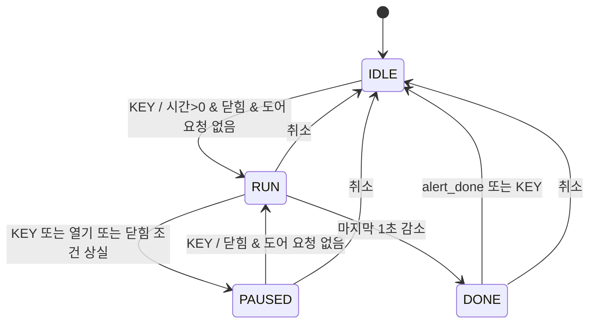

# STEP 5 시간·가열 제어 Interface

`microwave_controller.v`는 STEP 3에서 정한 시간 설정과 가열 FSM을 구현합니다.
모든 입력은 `clk` 도메인의 신호입니다. 외부 버튼은 `input_frontend`를 거쳐야 하며,
비동기 도어 센서 신호를 `door_closed`에 직접 입력하는 Interface가 아닙니다.

## 포트와 상태

| 포트 | 계약 |
| --- | --- |
| `clk`, `reset` | 100 MHz 클럭, `input_frontend.synced_reset`과 같은 active-high Reset |
| `tick_1ms` | 1 ms마다 한 클럭 enable. 내부 1,000회 누적으로 1초 감소 |
| `button_pulse[6:0]` | [입력 Interface](input_interface.md)의 동일한 이벤트 순서 |
| `rotary_cw`, `rotary_ccw` | 클릭당 한 클럭. 두 신호 동시 입력은 무시 |
| `door_closed` | STEP 8 도어 FSM이 제공하는 닫힘 추정 상태. 이전 단위 TB는 직접 공급 |
| `alert_done` | STEP 6 표시 완료 후 공급. DONE에서만 사용. STEP 7 종료음은 같은 표시 시간 기준 |
| `state[1:0]` | IDLE=0, RUN=1, PAUSED=2, DONE=3 |
| `remaining_seconds[11:0]` | 남은 총 초. 유효 범위 0~3,599 |
| `select_minutes` | 0=초 선택, 1=분 선택 |
| `run_enable` | 실행 허가 논리 신호. PWM 또는 실제 모터 출력이 아님 |
| `timeout_pulse` | 시간 만료로 DONE에 진입할 때 한 클럭 이벤트 |

Reset은 어느 상태에서도 IDLE·0초·초 선택·부분 시간 0으로 초기화합니다.
취소도 같은 제어 값을 초기화합니다. 통합 Top에서 다른 모듈도 취소/Reset 조건을
받아 처리하며, 이동 중 취소와 안정 위치에서의 서보 유지 정책은 도어 제어부를 따릅니다.

## 시간 설정과 계수

- IDLE에서만 `btnL`로 초/분 선택을 전환하고 CW/CCW로 선택 필드를 1씩 변경합니다.
- 분과 초는 각각 0~59로 포화합니다. 설정 시 carry/borrow 없이 다른 필드를 보존합니다.
- 시작 클럭에는 시간을 감소시키지 않고 이후 tick부터 계수합니다.
- RUN에서 1,000 tick마다 총 초를 1 감소합니다. RUN/PAUSED의 시간 편집은 무시합니다.
- 일시정지와 열기 중단은 부분 시간도 보존합니다. 재개 직후 1초를 새로 기다리지 않습니다.
- 닫힘만으로 재개하지 않습니다. 닫힘 상태에서 별도 KEY가 필요합니다.
- DONE은 알림 완료 또는 KEY 확인을 기다립니다. 3회 점멸 타이머는 표시 제어부가 담당합니다.
- 속도 +/- 입력은 이번 제어부에서 해석하지 않으며 시간 계수를 방해하지 않습니다.

## 동시 이벤트 우선순위

Reset > 취소 > 열기 > 닫기 > RUN 중 닫힘 조건 상실 > 만료 > KEY > 필드 선택 > 회전.

열기/닫기 요청 클럭에는 계수와 시작/재개를 하지 않습니다. RUN에서 열기 또는 닫힘 조건
상실은 PAUSED로 전환합니다. 닫기 요청 자체는 RUN 상태를 변경하지 않으며, 실제 도어
FSM의 닫힘 조건이 없어지면 PAUSED가 됩니다. 이미 닫혔을 때의 중복 닫기는 해당 요청
클럭만 계수를 보류하고 다음 tick부터 계속합니다.

마지막 tick과 열기가 겹치면 남은 1초와 부분 시간 999를 보존해 PAUSED가 됩니다.
마지막 tick과 KEY가 겹치면 DONE이 우선입니다. IDLE에서 필드 선택과 회전이 겹치면
필드만 전환하며, 시작 KEY와 회전이 겹치면 회전은 반영하지 않습니다.

`run_enable`은 RUN·닫힘뿐 아니라 현재 Reset·취소·열기·닫기·KEY·만료로 조합 차단합니다.
따라서 상태 레지스터 갱신 전에도 정지 요청이 구동 허가에 반영됩니다.
만료 차단은 STEP 9 모터 연계에서 추가했으며, 만료와 동시 속도 입력의 설정 변경도 방지합니다.
이는 동기화·debounce 이후 이벤트에 대한 규칙이며 외부 물리 스위치에 대한 무지연 정지는 아닙니다.

## 검증 경계

`tb_microwave_controller`는 1클럭을 논리적 1 ms tick으로 사용하지만 내부 1,000회 계수는
축소하지 않습니다. `tb_input_controller`는 실제 입력 RTL의 tick/debounce Parameter만
축소해 원시 입력부터 제어 결과까지 검사합니다. 둘 다 실제 보드 결과가 아닙니다.
STEP 6의 `tb_controller_display`에서 FND 및 완료 통지를 연결해 추가 검증했습니다.
STEP 7의 `tb_display_sound`에서 같은 종료 시간 기준의 부저도 연결해 검증했습니다.
STEP 8의 `tb_door_control`에서 도어 FSM·서보의 닫힘 추정과 개폐 중단/재개를 연결해 검증했습니다.
STEP 9의 `tb_motor_control`에서 모터 PWM과 실행/도어 조건을 연결해 검증했습니다.
STEP 10의 `tb_top_microwave_oven`에서 실제 보드 포트부터 전체 논리 출력까지 검증했습니다.
실제 Hardware는 미확인입니다. 연결과 시나리오는 [전체 통합](integration.md)을 따릅니다.
