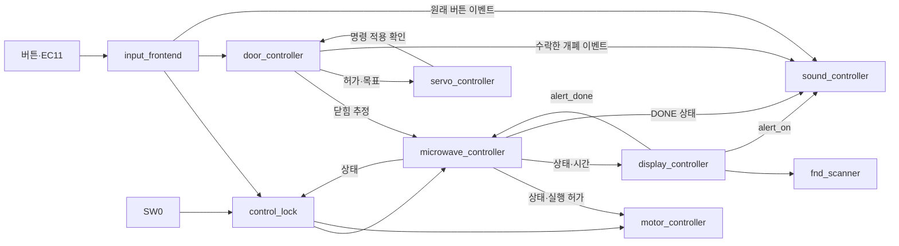
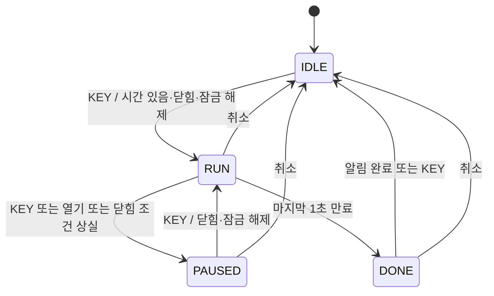
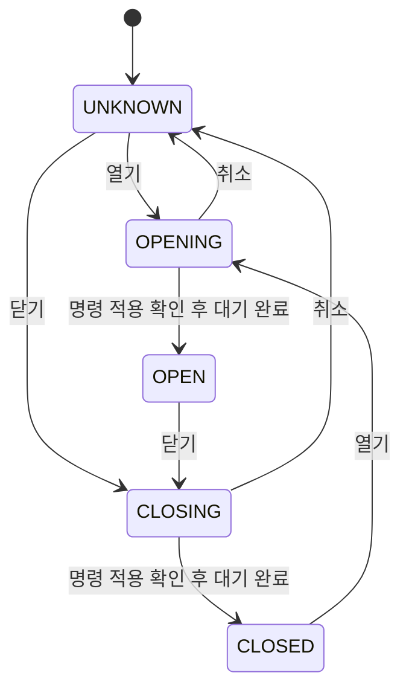

# 설계 설명

## 제어 흐름

전체 Top은 배선과 상태 LED를 담당합니다. 입력 계층의 Reset 동기화기·tick·debouncer·
rotary decoder를 포함해 RTL 파일은 14개입니다. 외부 입력만 비동기이며, 나머지는 모두
100 MHz `clk`를 사용합니다. `tick_1ms`는 새 클럭이 아닌 한 클럭 폭의 enable입니다.

| 경계 | 전달하는 의미 |
| --- | --- |
| 입력 → 제어 | 극성을 정규화한 누름 이벤트와 회전 방향 |
| 잠금 → 가열/모터 | 설정·시작·재개는 잠금에 따라 차단하고 정지·취소·개폐는 전달 |
| 도어 → 가열 | 명령·대기 시간에 따른 닫힘 추정 |
| 서보 → 도어 | 목표를 프레임 시작에서 적용했다는 확인 |
| 가열 → 모터 | RUN 상태와 정지 요청을 반영한 실행 허가 |
| 표시 → 가열/부저 | 완료 통지와 공유 종료 알림 envelope |

## 가열 FSM

Reset은 어느 상태에서나 IDLE·0초·초 선택으로 초기화합니다. 분·초 편집은 IDLE에서만
허용하고 각 필드를 0~59로 포화시킵니다. 1초 미만의 누적 시간을 보존하므로 일시정지/재개마다
새 1초를 기다리는 방식으로 시간이 늘어나지 않습니다.

동시 이벤트 우선순위는 Reset → 취소 → 열기 → 닫기 → 닫힘 조건 상실 → 만료 →
KEY → 필드 선택 → 회전입니다. 정지 이벤트는 상태 레지스터 갱신 전에도 실행 허가를
차단합니다. 이는 입력 동기화·필터 이후의 논리 동작이며 물리 스위치의 무지연 반응을 뜻하지 않습니다.

## 도어 FSM

Reset 시 문이 닫혔다고 가정하지 않습니다. 서보 프레임에 목표가 적용된 뒤 기본 500 ms를
계수하고 OPEN/CLOSED로 추정합니다. 적용 확인은 프레임 시작을 뜻하며 실제 도착 피드백이 아닙니다.
닫힌 뒤 가열을 자동 재개하지 않고 KEY를 다시 요구합니다. 이동 중 중복·반대 요청은
무시하되 적용 확인과 대기 계수는 계속 처리합니다.

모터·서보 출력은 주기 카운터와 래치로 제어합니다. 별도 FSM을 추가하지 않았습니다.
부저는 BEEP_IDLE/BEEP_ON/BEEP_GAP 상태와 개폐 효과음 큐를 사용합니다.

## 설계 선택

| 선택 | 목적·제약 | 확인 근거 |
| --- | --- | --- |
| 2단 동기화 + 안정화 필터 | 비동기 접점과 짧은 잡음 처리, 10 ms 버튼/2 ms 로터리 기본값 | 입력 TB·기본 Timing TB·CDC |
| 단일 클럭 + enable | 상태·카운터·출력 사이 클럭 도메인 분리 방지 | Top 연결·100 MHz STA |
| 실행 허가의 조합 차단 | 취소·개폐·KEY·만료 시 다음 상태만 기다리지 않고 구동 차단 | 모터/Top TB |
| 주기 시작에서 목표 래치 | HIGH/LOW 도중 속도·서보 목표 변경에 따른 중간 펄스 변경 방지 | 모터·서보 TB |
| FND 자리 전환 시 2클럭 소등 | 패턴 선출력 후 다음 자리 활성화 | 표시 TB, 실제 잔상 측정과 구분 |
| 종료 표시·소리의 시간 기준 공유 | 두 알림의 별도 타이머 불일치 방지 | 표시/부저 연계 TB |
| 완료 통지를 DONE 종료까지 유지 | 상위 이벤트와 겹쳐도 완료 통지를 잃지 않음 | 제어/표시 연계 TB |
| 잠금 해제 직후 한 클럭 차단 | 해제와 같은 시점의 KEY·설정 이벤트 재사용 방지 | 실제 VCD·잠금 Top TB |

BEEP은 도어 효과음보다 우선하며 중단한 효과음은 이어 재생합니다. 종료 알림의 3초 기준은
상위 소리가 재생돼도 늘어나지 않습니다. 큐는 유한하며 초과 시 LD13으로 알립니다.
도어 취소는 이동 중 서보를 차단하지만 안정 위치의 유지 펄스는 계속 출력합니다.

## 모듈별 동작 규칙

| 모듈 | 핵심 규칙 |
| --- | --- |
| input_frontend | 버튼 비트 0→6: 필드·속도+·속도−·취소·열기·닫기·KEY. 기동 시 눌린 버튼은 놓고 다시 눌러야 이벤트 발생 |
| rotary_decoder | CW 전이 00→10→11→01→00, 역전은 누적량 상쇄, invalid 전이는 누적량 폐기 |
| control_lock | 준비 전에도 잠금, 실행은 계속, 설정/시작/재개만 차단. RUN 정지·DONE 확인·취소·개폐 허용 |
| microwave_controller | 1초=1,000 tick, 남은 시간 12비트·0~3,599초. 필드별 편집은 carry/borrow 없이 포화 |
| display_controller / fnd_scanner | MM.SS·circle 1초 교대, 점멸 반주기 500 ms. 자리 스캔 1 ms, 전환 시 2클럭 소등 |
| sound_controller | BEEP→도어 효과음→종료음 순. BEEP 40/20 ms, 개폐 70 ms×3단계, 종료 표시와 3초 기준 공유 |
| door_controller / servo_controller | Reset은 UNKNOWN·출력 차단, 안정 위치 취소는 유지 펄스 지속. 명령 적용 확인 뒤 이동 대기 |
| motor_controller | 요청 듀티와 현재 주기 적용값 분리, 구동 허가 상실 시 출력 차단, 재개 시 새 주기 |

BEEP은 대기 15개, 도어 효과음은 FIFO 4개까지 보존하며 각각 현재 재생 1개는 별도입니다.
초과는 LD13으로 표시하고 Reset/취소로 해제합니다. 취소는 대기 소리를 버리고 취소 BEEP을 남깁니다.
종료 완료 신호 `alert_done`은 DONE을 떠날 때까지 유지해 상위 이벤트와 겹쳐도 통지를 잃지 않습니다.

Top Parameter 기본값과 변경 조건

기준 클럭은 100 MHz입니다. 시간 계수는 양의 정수로 설정합니다.

| Parameter | 기본값·의미 |
| --- | --- |
| TickCount | 100,000 → 1 ms enable |
| ButtonDebounceCount / RotaryDebounceCount | 1,000,000 / 200,000 → 10 ms / 2 ms |
| StepsPerDetent | 4, 유효 위상 전이 누적 수 |
| ServoFrameClocks | 2,000,000 → 20 ms, 2 이상 |
| ClosedPulseClocks / OpenPulseClocks | 100,000 / 150,000 → 1 / 1.5 ms, 1 이상·프레임 미만 |
| MoveTimeMs | 500 → 명령 적용 후 500 ms 대기 |
| PwmPeriodClocks | 100,000 → 1 kHz, 10 이상의 10 배수 |
| PassiveBuzzer | 0=ON/OFF, 1=2 kHz 반송파 사용 |

서보 펄스는 기구 보정 전 초기값이며 특정 각도를 보장하지 않습니다.
입력 필터는 2단 동기화 이후의 안정 기간을 계수합니다. 기동 대기는 큰 필터 계수+4클럭입니다.
SW0는 버튼과 같은 계수로 필터링합니다. FND 스캔용 tick은 최소 3클럭 간격이어야 합니다.

핀·조작은 [하드웨어](hardware.md), 테스트와 Timing은 [검증 결과](verification.md)를 참고하세요.
