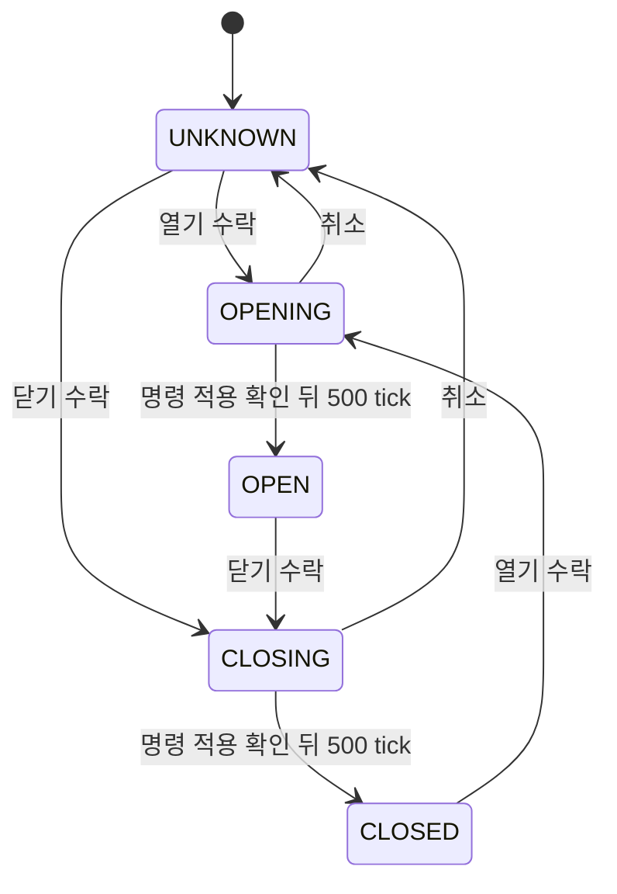

# STEP 8 서보·도어 Interface

`door_controller`는 개폐 상태와 이동 대기를 관리하고 `servo_controller`가 펄스를 생성합니다.
가열 제어부에는 닫힘 추정 상태, 부저에는 수락한 개폐 이벤트만 전달합니다.
센서 피드백이 없으므로 명령 적용과 시간 경과를 실제 문 위치 확인으로 표현하지 않습니다.

## 서보 펄스

| 포트/Parameter | 계약 |
| --- | --- |
| `clk`, `reset` | 100 MHz, 동기 해제된 active-high Reset |
| `enable` | 0이면 펄스 즉시 차단, 다음 활성화 시 새 프레임 시작 |
| `target_open` | 열림 목표 1, 닫힘 목표 0 |
| `servo_pwm` | 지정한 폭의 active-high 펄스 |
| `command_applied` | 첫 활성화 또는 목표 변경을 프레임 시작에서 적용할 때 한 클럭 |
| `FrameClocks` | 기본 2,000,000: 100 MHz에서 20 ms 프레임 |
| `ClosedPulseClocks` | 기본 100,000: 1 ms 닫힘 목표 펄스 |
| `OpenPulseClocks` | 기본 150,000: 1.5 ms 열림 목표 펄스 |

`FrameClocks >= 2`, `1 <= 각 펄스 폭 < FrameClocks` 조건을 지켜야 합니다.
목표는 프레임 시작에서만 반영하여 HIGH 도중 폭이 바뀌지 않도록 합니다.
변경되지 않은 목표의 반복 프레임에서는 command_applied를 재발행하지 않습니다.
정지/Reset은 프레임 완료를 기다리지 않고 차단하므로 진행 중 펄스가 짧아질 수 있습니다.

20 ms와 1/1.5 ms는 과제의 서보 파형 예시를 바탕으로 정한 **보정 전 초기값**입니다.
이를 특정 각도, 실제 문 개폐 방향 또는 안전한 기계 가동 범위로 보장하지 않습니다.
[TowerPro SG90 공식 자료](https://towerpro.com.tw/product/sg90-7/)도 실제 보유 서보의 버전,
혼 설치 방향과 모형 문의 기하를 확인하는 자료를 대신하지 못합니다.
실기에서 링크/혼을 분리한 상태의 회전 방향·범위를 먼저 확인하고 목표 폭을 보정해야 합니다.

## 도어 FSM

| 포트/Parameter | 계약 |
| --- | --- |
| `tick_1ms` | 기존 1 ms enable |
| `open_request`, `close_request`, `cancel` | 기존 button_pulse[4], [5], [3] |
| `command_applied` | 연결된 서보 모듈의 명령 적용 확인 |
| `state[2:0]` | UNKNOWN=0, CLOSED=1, OPENING=2, OPEN=3, CLOSING=4 |
| `door_closed` | CLOSED이고 Reset/열기 요청이 없을 때 1인 추정 상태 |
| `servo_enable`, `target_open` | 서보 모듈 제어 입력 |
| `open_event`, `close_event` | 수락한 개폐 요청당 한 클럭, 부저 효과음 입력 |
| `MoveTimeMs` | 기본 500: 명령 적용 확인 이후 기다리는 tick 수 |

Reset은 UNKNOWN과 펄스 비활성으로 시작합니다. 초기화를 실제 닫힘으로 간주하지 않습니다.
닫기 수락, 서보 command_applied, 이동 대기를 모두 거친 뒤에만 가열 시작을 허용합니다.
이동 시간은 프레임 명령 적용 **시작**에 대한 확인 이후 계수하며, 서보 도착 피드백은 아닙니다.
500 tick은 설계 초기값이며 부하·전원·기구 조건에서 도착을 보장하는 사양이 아닙니다.
전역 tick 위상에 따라 실제 대기 길이에는 1 ms 미만 차이가 있습니다.

우선순위는 Reset > 취소 > 열기 > 닫기입니다. 이동 중에는 새 요청을 무시하지만
명령 확인과 이동 계수는 계속 처리합니다. 같은 위치 요청은 재수락하지 않으며,
OPEN에서 열기/닫기가 동시에 들어와도 열기 우선이므로 닫기를 수락하지 않습니다.

이동 중 취소는 펄스를 차단하고 UNKNOWN으로 돌아갑니다. OPEN/CLOSED에서 취소는
위치 유지를 위한 펄스를 유지합니다. Reset은 어느 상태에서든 펄스를 차단합니다.
펄스 차단을 기계적인 즉시 정지나 위치 고정으로 해석하지 않습니다.

## 기존 기능과 연결

- `door_closed`는 `microwave_controller.door_closed`로 전달합니다.
- 열기 요청은 기존 가열 제어부에서도 직접 처리하므로 RUN을 중단하고 남은 시간을 보존합니다.
- 닫힌 뒤 자동 재개하지 않으며 별도 KEY가 필요합니다.
- 수락된 open/close_event만 부저에 전달합니다. 무시된 이동/중복 요청에는 버튼 BEEP만 남습니다.
- 완료 위치에서는 펄스를 계속 출력하여 유지 명령을 보냅니다.
- 기존 핀은 열기 J3, 닫기 L3, 서보 신호 JB1/A14이며 XDC는 아직 변경하지 않았습니다.

현재는 논리적 연결을 TB로 확인했습니다. 실제 서보 전원·신호 조건, 기구 보정,
부하에서의 이동 시간과 실제 개폐는 미검증입니다. 보드용 Top·다운로드는 이후 준비합니다.
