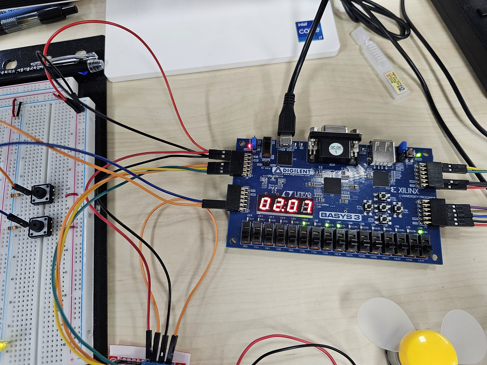

# 하드웨어와 조작

Basys3, EC11 로터리, SG90 서보, SM-1205C 부저, R300 모터와 L298N 드라이버를 사용합니다.
외부 택트 스위치 2개는 문 열기·닫기 요청용입니다. 전원은 현재 구성의 Basys3 Pmod 3.3 V를 사용합니다.

[전체 구성 사진](assets/hardware_overview.jpg) · [실제 시연 영상](https://github.com/user-attachments/assets/1a4a421e-5a51-4ae9-986a-bdd6589ca600)

## 조작

| 입력 | 기능 |
| --- | --- |
| EC11 회전 / btnL | 시간 ±1 / 분·초 선택, IDLE에서만 편집 |
| EC11 KEY | 시작·일시정지·재개, 종료 알림 확인 |
| 외부 J3 / L3 스위치 | 문 열기 / 닫기 요청 |
| btnU / btnD | PWM 듀티 증가 / 감소, 기본 50% |
| btnR | 취소, 시간 초기화·속도 유지 |
| btnC | 전체 Reset, 시간 0·속도 50%·도어 UNKNOWN |
| SW0 | 1=조작 잠금·LD14 켜짐, 0=해제 |

잠금 중에도 실행은 계속되며 KEY 일시정지·종료 확인, 취소·Reset·개폐는 가능합니다.
잠금 해제만으로 시작하지 않으며, 누르고 있던 KEY는 놓고 다시 눌러야 합니다.
차단된 버튼에도 BEEP은 재생합니다.

## 핀 연결

Design Top은 `top_microwave_oven`이며 활성 제약은
[microwave_basys3.xdc](../fpga-microwave-oven.srcs/constrs_1/new/microwave_basys3.xdc)입니다.
J3/L3 외부 풀다운 결선을 유지합니다. EC11 KEY는 active-low입니다.

| Top 포트 | Basys3 위치 / FPGA 핀 | 역할 |
| --- | --- | --- |
| `clk` | W5 | 100 MHz |
| `lock_switch` | 보드 SW0 / V17 | 1=조작 잠금, 0=해제 |
| `btnC` | 중앙 / U18 | 전체 Reset |
| `btnL` | 왼쪽 / W19 | 분·초 선택 |
| `btnU`, `btnD` | 위 T18 / 아래 U17 | 속도 증가·감소 |
| `btnR` | 오른쪽 / T17 | 취소 |
| `door_open` | JXADC1 / J3 | 열기 요청, 외부 풀다운 유지 |
| `door_close` | JXADC2 / L3 | 닫기 요청, 외부 풀다운 유지 |
| `rotary_s1`, `rotary_s2` | JC2 M18 / JC3 N17 | EC11 S1 / S2 |
| `rotary_key` | JC4 / P18 | EC11 KEY, active-low |
| `servo_pwm` | JB1 / A14 | SG90 제어 신호 |
| `buzzer` | JB2 / A16 | 부저 제어 신호 |
| `motor_pwm` | JA1 / J1 | L298N ENA, PWM 사용 시 ENA 점퍼 제거 |
| `motor_in1`, `motor_in2` | JA2 L2 / JA3 J2 | L298N IN1 / IN2 |
| `seg[7:0]` | DP,g,f,e,d,c,b,a | 보드 FND, active-low |
| `an[3:0]` | 보드 4자리 선택 | active-low |
| `led[15:0]` | 보드 LED | 아래 상태 표시 |

## 상태 LED

| LED | 의미 |
| --- | --- |
| LD0 | 입력 안정화 완료 |
| LD1 | 가열 실행 허가 |
| LD2 | PAUSED |
| LD3 | DONE |
| LD4 | 닫힘 **추정** |
| LD5 | 열림 **추정** |
| LD6 | 개폐 이동 대기 |
| LD7 | 도어 UNKNOWN |
| LD9:LD8 | 속도 이진값 00/01/10/11 = 30/50/70/90% |
| LD10 | 분 선택, 꺼지면 초 선택 |
| LD11 | 서보 펄스 허가 |
| LD12 | 소리 envelope |
| LD13 | 소리 큐 초과, Reset/취소로 해제 |
| LD14 | 조작 잠금, 입력 안정화 전에도 잠금으로 취급 |
| LD15 | 내부 Reset |

## 실제 보드 확인 순서

Bitstream 다운로드 후 SW0=0에서 시작합니다.

| 순서 | 조작 | 확인할 동작 |
| --- | --- | --- |
| 1 | btnC → 시간 설정 → 닫기 | 00.00에서 설정 가능, UNKNOWN → 이동 대기 → 닫힘 추정 |
| 2 | KEY 시작 → btnU/D → KEY 정지·재개 | 카운트다운·모터 구동·속도 변경, 남은 시간 보존 |
| 3 | 실행 중 열기 → 닫기 → KEY | 열기 요청으로 구동 차단, 닫기만으로 재개하지 않음 |
| 4 | 실행 중 btnR, 이후 btnC | 취소는 속도 유지, Reset은 50%·UNKNOWN |
| 5 | SW0=1 → 설정·KEY → 해제·새 KEY | 설정/시작 차단, LD14 표시, 해제 후 새 누름으로 시작 |
| 6 | 5초 실행 후 대기 | 구동 차단·0000/종료음 3회·IDLE 복귀 |

2026-10-28 기준 기본 기능과 새 SW0 기능은 사용자 정상 동작 확인 상태입니다.
사진과 영상은 실제 구성·동작을 소개합니다.
Simulation·Timing·실기 확인의 구분은 [검증 결과](verification.md)를 참고하세요.
문 위치는 명령·대기 시간으로 추정합니다. PWM 듀티를 RPM으로, 출력 차단을 축의 즉시 정지로 해석하지 않습니다.
전압·전류·부하 및 실제 서보 도착 시간은 측정하지 않았습니다.
