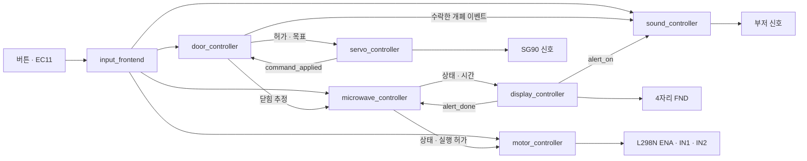

# 전체 모듈 통합

STEP 10의 Design Top은 `top_microwave_oven`, Simulation Top은
`tb_top_microwave_oven`입니다. 기본 Parameter는 Basys3의 100 MHz를 기준으로 합니다.
모든 모듈은 동일한 `clk`를 사용하며 `tick_1ms`는 clock enable입니다.

## 보드 연결 계약

활성 XDC는 `fpga-microwave-oven.srcs/constrs_1/new/microwave_basys3.xdc` 하나입니다.
기존 Digilent Master XDC는 핀 대조용으로 보존하며 프로젝트에는 등록하지 않습니다.

| Top 포트 | Basys3 위치 / FPGA 핀 | 역할 |
| --- | --- | --- |
| `clk` | W5 | 100 MHz |
| `btnC` | 중앙 / U18 | 전체 Reset |
| `btnL` | 왼쪽 / W19 | 분·초 선택 |
| `btnU`, `btnD` | 위 T18 / 아래 U17 | 속도 증가·감소 |
| `btnR` | 오른쪽 / T17 | 취소 |
| `door_open` | JXADC1 / J3 | 열기 요청, 외부 풀다운 유지 |
| `door_close` | JXADC2 / L3 | 닫기 요청, 외부 풀다운 유지 |
| `rotary_s1`, `rotary_s2` | JC2 M18 / JC3 N17 | EC11 S1 / S2 |
| `rotary_key` | JC4 / P18 | EC11 KEY, active-low 가정 |
| `servo_pwm` | JB1 / A14 | SG90 제어 신호 |
| `buzzer` | JB2 / A16 | 부저 제어 신호 |
| `motor_pwm` | JA1 / J1 | L298N ENA, PWM 사용 시 ENA 점퍼 제거 |
| `motor_in1`, `motor_in2` | JA2 L2 / JA3 J2 | L298N IN1 / IN2 |
| `seg[7:0]` | DP,g,f,e,d,c,b,a | 보드 FND, active-low |
| `an[3:0]` | 보드 4자리 선택 | active-low |
| `led[15:0]` | 보드 LED | 아래 상태 표시 |

새 센서는 추가하지 않았습니다. J3/L3 풀다운 및 기존 핀 위치를 유지하며 내부 pull을 추가하지 않습니다.
입력 도착 시간은 비동기이므로 입력 포트에 한정해 false path를 적용합니다.
동기화 FF 간 경로와 이후 로직은 10 ns 클럭으로 검사합니다.
LED/FND/액추에이터 출력의 외부 동기 수신기 Timing 규격은 정의하지 않았으므로
외부 output delay는 임의로 만들지 않습니다. 내부 Timing 결과와 외부 출력 검증을 구분합니다.

## 상태 LED

| LED | 의미 |
| --- | --- |
| LD0 | 입력 안정화 완료 |
| LD1 | 가열 실행 허가 |
| LD2 | PAUSED |
| LD3 | DONE |
| LD4 | 닫힘 **추정** |
| LD5 | 열림 **추정** |
| LD6 | 개폐 이동 대기 |
| LD7 | 도어 UNKNOWN |
| LD9:LD8 | 속도 이진값 00/01/10/11 = 30/50/70/90% |
| LD10 | 분 선택, 꺼지면 초 선택 |
| LD11 | 서보 펄스 허가 |
| LD12 | 소리 envelope |
| LD13 | 소리 큐 초과, Reset/취소로 해제 |
| LD14 | 로터리 invalid 이벤트, 1클럭이므로 육안 관찰용 아님 |
| LD15 | 내부 Reset |

Reset 후에는 도어 UNKNOWN으로 시작하며 자동으로 서보를 움직이지 않습니다.
닫기 요청 → 서보 명령 프레임 적용 → 기본 500 ms 대기 후 CLOSED로 추정합니다.
0이 아닌 시간을 설정하고 KEY를 눌러야 가열을 시작합니다.
닫기만으로 일시정지에서 자동 재개하지 않습니다.
이동 중 취소하면 서보를 차단하고 UNKNOWN으로 돌아가므로 다시 개폐 요청이 필요합니다.

## 검증과 실기 확인 순서

`tb_top_microwave_oven`은 내부 이벤트 강제 주입 없이 실제 Top의 버튼·로터리 포트를 구동합니다.
tick 간격, debounce, PWM/서보 주기와 이동 대기만 축소합니다.
시간 계수의 1초=1,000 tick, 완료 알림의 3초=3,000 tick은 유지합니다.
기본 주기와 펄스 폭 검사는 기존 단위 TB가 담당합니다.
검사 중 모터 실행 허가·서보 허가·FND 자리 선택 조건도 매 클럭 확인합니다.

실기 검증 시 관찰할 순서입니다. 아직 완료 기록이 아닙니다.

1. Reset 후 LD0/LD7, `00.00`, 모터 정지를 확인합니다.
2. EC11의 한 detent 증가·감소 및 KEY 극성을 확인합니다. 방향이 반대면 S1/S2 대응을 먼저 확인합니다.
3. 개폐 요청과 LD6→LD4/LD5를 대조하고 실제 문 각도·도착을 확인합니다.
4. 5초 설정 → 닫기 → KEY 시작 → KEY 정지/재개 → 열기 중단을 확인합니다.
5. 닫은 후 KEY로 재개하고 속도 네 단계, 취소와 자연 만료를 확인합니다.
6. 종료 시 0000 3회 점멸·부저·IDLE 복귀를 영상으로 기록합니다.

서보 20 ms 프레임의 1/1.5 ms 폭과 500 ms 이동 대기는 기구 보정 전 값입니다.
실제 닫힘 센서가 없으므로 이 상태를 안전 인터록의 실측값으로 해석할 수 없습니다.
`PassiveBuzzer=0`이 기본이며 부저 종류·음량·직결 전기 조건은 실기 미확인입니다.
외부 부품 전원·구동 적합성과 실제 회전·개폐는 Bitstream 생성 성공으로 확인되지 않습니다.
자체 아이디어, 최종 실기 검증과 발표자료는 후속 단계입니다.
