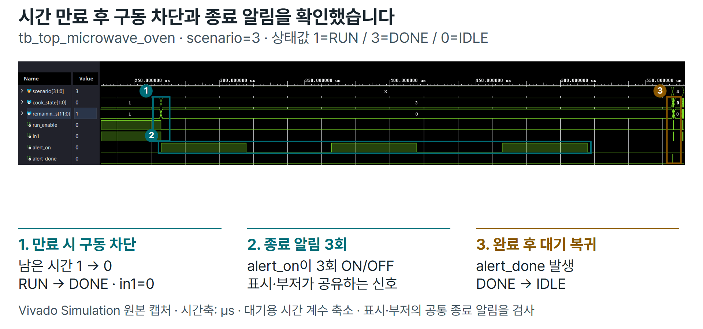
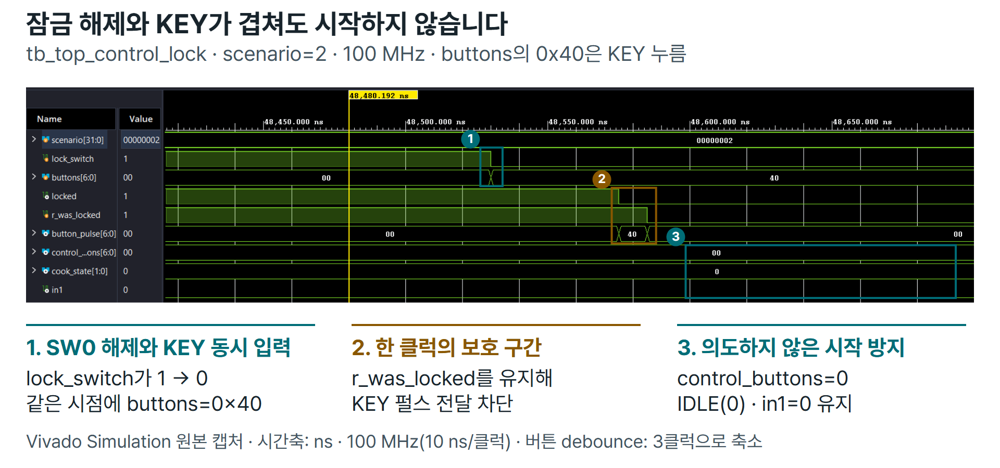

# 검증 결과

2026-10-28, Vivado/XSim 2026.1(build 6511674), Basys3 `xc7a35tcpg236-1` 기준입니다.
조작 잠금을 포함한 기능 기준은 `7bb28f1`이며 이후 문서·서식 정리는 기능 변경이 아닙니다.

## 확인 범위

| 구분 | 결과 |
| --- | --- |
| RTL Simulation | Testbench 16개 모두 PASS, compile/elaboration/Simulation 경고·오류 없음 |
| 저장소·설정 | RTL 14개·TB 16개 등록, 활성 핀 45개·100 MHz·문서 링크 검사 PASS, 설정 회귀 9개 OK |
| 합성·배치배선 | Bitstream 생성, DRC 위반·routing error 각각 0 |
| 실제 보드 | 기본 기능과 SW0 잠금 정상 동작 확인 보고, [구성 사진](hardware.md)·[시연 영상](https://github.com/user-attachments/assets/339a04de-37d3-44b4-93c6-2343d36fdcb4) 확보 |

## 실제 시연 영상

[영상 재생](https://github.com/user-attachments/assets/339a04de-37d3-44b4-93c6-2343d36fdcb4) · [원본 MP4](assets/microwave_oven_demo.mp4)

시연 영상 파일을 저장소에도 함께 보관했습니다. 재생에는 위 GitHub 첨부 주소를 사용합니다.
기본 기능과 SW0 잠금의 실기 정상 보고, 사진·영상, 아래 Simulation 결과는 확인 방식을 구분합니다.
영상은 동작 소개 자료이며 전기적 측정이나 모든 경계 조건의 실기 검증을 대신하지 않습니다.
서보에 실제 문이 연결된 구성은 아니므로 문 위치는 서보 명령·대기 시간으로 추정합니다.

## Testbench 범위

각 이름은 `fpga-microwave-oven.srcs/sim_1/new/`의 실제 TB에 대응합니다.

| 영역 | Testbench | 주요 확인 |
| --- | --- | --- |
| 시간 기반·입력 | tb_timebase, tb_input_frontend | Reset·tick 간격·기동 억제·버튼 7개·bounce/hold·극성·로터리 정역전/오류 복구 |
| 시간 제어 | tb_microwave_controller, tb_input_controller | 시간 경계·부분 초 보존·만료·동시 이벤트 우선순위 |
| 표시 | tb_display_controller, tb_controller_display | 3,600개 시간 값·자리 스캔·화면 교대·3회 알림·완료 통지 |
| 부저 | tb_sound_controller, tb_display_sound | 리듬·우선순위·동시 요청·큐 초과·종료 표시와 envelope 일치 |
| 도어·서보 | tb_servo_controller, tb_door_controller, tb_door_control | 프레임/펄스 폭·명령 적용·이동 대기·중복 요청·취소·시작 차단 |
| 모터 | tb_motor_controller, tb_motor_control | 네 듀티·주기 경계 갱신·정지/재개·만료와 속도 입력 충돌 |
| 조작 잠금 | tb_control_lock, tb_top_control_lock | 네 상태별 128개 버튼 조합·기동·잡음·잠금 해제/KEY 경계·허용 조작 |
| 전체 통합 | tb_top_microwave_oven | 원시 보드 입력부터 표시·소리·서보·모터까지 전체 시나리오 |

통합 TB는 대기용 계수를 축소하되 1초=1,000 tick 계수는 유지합니다.
기본 PWM 1 kHz·서보 20 ms/1~1.5 ms 파형은 단위 TB에서 별도로 검사합니다.

## 합성·Timing

| 항목 | 결과 |
| --- | --- |
| 클럭 | 100 MHz / 10 ns |
| Setup WNS / Hold WHS | +0.222 ns / +0.122 ns |
| TNS / THS, 실패 endpoint | 0 / 0, 각각 0 |
| Pulse width slack | +4.500 ns |
| 내부 no_clock·미제약 endpoint·loops | 0 |
| LUT / FF | 824 / 20,800 (3.96%) · 459 / 41,600 (1.10%) |
| IOB / BUFG | 45 / 1 |
| CDC | 동기화 정보 11개, 경고 없음 |

남은 경고와 해석:

- **TIMING-18 32개:** 외부 출력의 동기 수신 Timing 요구를 정의하지 않았습니다. 내부 STA 통과와 외부 I/O Timing 보장은 구분합니다.
- **Synth 8-6014 / 8-7129:** 기본 부저 모드에서 사용하지 않는 반송파와 모듈별 미사용 버튼 비트입니다.
- 초기 LUTAR-1 경고는 기동 대기를 동기식 enable로 분리한 뒤 제거했습니다. [수정 과정](troubleshooting.md)

## 대표 시나리오 파형

### 시간 만료와 종료 알림

[원본 캡처](assets/tb_completion_raw.png) · `tb_top_microwave_oven`, scenario=3

### 잠금 해제와 KEY 동시 입력

[원본 캡처](assets/tb_control_lock_raw.png) · `tb_top_control_lock`, scenario=2

두 이미지는 Vivado Simulation 캡처에 설명을 추가한 자료입니다. 대기·필터 계수는 축소했으며
하드웨어 실측과 구분합니다. 설명 이미지는 PPT와 GitHub에서 바로 사용하는 PNG로 제공합니다.

잠금 경계의 VCD 데이터와 재생성

같은 잠금 경계 시나리오의 XSim 데이터를 별도로 추출했습니다.
100 MHz 클럭, 버튼 필터 3클럭 조건에서 원본 48,510~48,630 ns를 발췌했으며
동시 입력 시점 48,530 ns를 0으로 표시한 파형입니다.
KEY raw는 눌림을 1로 나타낸 TB 신호이고 실제 KEY 포트는 active-low입니다.
같은 시각의 델타 갱신은 마지막 값으로 표시했습니다.

[추출 파형 PNG](evidence/control_lock_boundary.png) · [벡터 SVG](evidence/control_lock_boundary.svg) ·
[VCD](evidence/control_lock_boundary.vcd) · [SHA-256·시간 구간](evidence/control_lock_boundary.json) ·
[재생성 방법](reproduction.md)

## 근거와 한계

로컬 실행 결과는 Git에서 제외한 다음 경로에 저장했습니다. 새 실행은 [실행 방법](reproduction.md)을 따릅니다.

| 구분 | 기록 |
| --- | --- |
| 전체 회귀 | build/step11/20261028_152816_897567/ |
| 합성·배치배선·STA | build/board/20261028_152128_18104/ |
| 파형 추출 재실행 | build/portfolio_evidence/export_console.txt, tb_top_control_lock PASS |

공개 VCD는 원본 구간과 신호별로 대조하고 해시를 확인했습니다. PNG·SVG·VCD의 동일 재생성과 이미지 표시를 확인했습니다.
실기 정상 보고는 항목별 측정 결과와 구분합니다. 실제 RPM·전압/전류·문 도착 정확도는 측정하지 않았습니다.
